# AsthenoZero: Precision Ocular Ergonomics & Digital Asthenopia Suite
## Complete Technical, Clinical & Architectural Documentation

**Lead Author & Researcher:** Akansha Kashyap  
**LinkedIn:** [linkedin.com/in/akansha-kashyap-b6a32b362](https://www.linkedin.com/in/akansha-kashyap-b6a32b362)  
**System Classification:** Digital Health / Software as a Medical Device (SaMD) Investigational Prototype  
**Date of Release:** 2026  
**License:** Permissive Open-Source License (c) 2026 Akansha Kashyap  

---

## 1. Executive Summary

**AsthenoZero** is a closed-loop, non-invasive digital health platform engineered to quantify, monitor, and mitigate **Digital Eye Strain (Asthenopia)** and Computer Vision Syndrome (CVS). 

By uniting **machine learning predictive risk modeling**, **real-time privacy-preserving computer vision blink kinematics**, an **enforceable habit economy (AsthenoCredits & Strict Rehabilitation Protocol)**, and **nutritional ophthalmology prescriptions**, AsthenoZero transitions digital ocular care from passive symptomatic treatment to active, preventative ergonomics.

---

## 2. Clinical Problem Statement & Project Purpose

### 2.1 The Modern Asthenopia Epidemic
Modern display engagement subjects human vision to unprecedented focal and photochemical stress:
1. **Blink Reflex Arc Suppression:** Visual fixation during cognitively demanding screen tasks suppresses spontaneous blinking by **50% to 70%** (collapsing from a healthy baseline of 15–20 blinks/min to fewer than 5–7 blinks/min).
2. **Precorneal Tear Film Rupture:** The lipid monolayer secreted by tarsal Meibomian glands ruptures without regular eyelid apposition. Tear film break-up time (TBUT) falls under 5 seconds, causing evaporative dry eye, corneal friction, photophobia, and ocular inflammation.
3. **Ciliary Accommodative Spasm ("Pseudomyopia"):** Prolonged near-point convergence locks the intraocular ciliary sphincter in continuous isometric contraction, producing radiating frontal headaches, transient distance blur, and visual exhaustion.

### 2.2 Why AsthenoZero Was Built (The "Why")
Prior market solutions remain fragmented:
* **Generic 20-20-20 Timers:** Simple countdown beepers easily dismissed or cheated; lacking any biometric validation.
* **OpenCV Blink Scripts:** Noisy, uncontrolled measurements across random web usage that fail to isolate task-related cognitive load.
* **Paper Surveys (OSDI / CVS-Q):** Purely subjective snapshots disconnected from real-time workstation behavior.

AsthenoZero provides the first unified, closed-loop workstation platform that predicts, detects, rehabilitates, and rewards healthy visual ergonomics in real time.

---

## 3. High-Level System Architecture

AsthenoZero operates on a modular pipeline designed for client-side execution, low latency, and zero telemetry leakage:

```mermaid
flowchart TD
    subgraph UI["1. Modern Health-Tech UI Layer (Streamlit + Obsidian Dark Theme)"]
        A1["Tab 1: Clinical Risk Assessment"]
        A2["Tab 2: Live Blink Diagnostic (60s Test)"]
        A3["Tab 3: Habit Diary & Screen Budgeting"]
        A4["Tab 4: 20-20-20 Timer with Strict Interlock"]
        A5["Tab 5: Vision Gym & Ocular Physical Therapy"]
        A6["Tab 6: Care Guide & Ergonomic Audit"]
        A7["Sidebar: Credit Vault & Examiner Telemetry"]
    end

    subgraph ML["2. Machine Learning Predictive Core"]
        B1["Survey Dataset (N=139 Cohort)"] --> B2["Data Hygiene & Ordinal Encoder"]
        B2 --> B3["Grouped 5-Fold Cross-Validation"]
        B3 --> B4["L2 Ridge Regressor (CV MAE 2.40)"]
        B4 --> B5["Risk Severity & Factor Attribution Engine"]
    end

    subgraph CV["3. Real-Time Computer Vision Core"]
        C1["Webcam Video Stream"] --> C2["In-Memory MediaPipe 468-pt Face Mesh"]
        C2 --> C3["Bilateral Eye Aspect Ratio (EAR)"]
        C3 --> C4["5s Baseline Calibration"]
        C4 --> C5["Standardized 60s Reading Stimulus (231 words)"]
        C5 --> C6["Objective-Subjective Divergence Index (OSDI-Blink Delta)"]
    end

    subgraph ECON["4. Behavioral Economics & Strict Recovery"]
        D1["AsthenoCredits Credit Economy"] --> D2["Daily Habit Streak Engine"]
        D2 --> D3{"Streak Broken & Coins Depleted (0)?"}
        D3 -- "Yes" --> D4["Strict Clinical Rehabilitation Protocol (Physiological Lock)"]
        D4 --> D5["Complete Exercise + Optical Reset + Blink Test"]
        D5 --> D6["Streak Restored + 60 Coin Graduation Reward"]
    end

    subgraph NUTR["5. Clinical Pathology & Nutritional Ophthalmology"]
        E1["Ergonomic Inputs"] --> E2["5 Eye Condition Vulnerabilities (MGD, Spasm, Keratitis)"]
        E2 --> E3["Targeted Dietary Prescriptions (Omega-3, Lutein, Hydration)"]
        E3 --> E4["One-Click Exportable HTML/PDF Clinical Report"]
    end

    UI --> ML
    UI --> CV
    UI --> ECON
    UI --> NUTR
```



---

## 4. Machine Learning Predictive Pipeline

### 4.1 Study Cohort & Preprocessing
* **Sample Size:** $N = 139$ surveyed computer workers, university students, and office professionals.
* **Input Features:**
  1. `age_group` (Categorical: 15–18, 19–24, 25–34, 35–45, 45+)
  2. `screen_time_category` (Ordinal: $<2$h, 2–4h, 4–6h, 6–8h, $>8$h)
  3. `sleep_category` (Ordinal: $<5$h, 5–6h, 6–7h, 7–8h, $>8$h)
  4. `breaks_per_hour_category` (Ordinal: 0, 1–2, 2–3, 4–5, 5+)
  5. `primary_device` (Categorical: Laptop/PC, Phone, Tab, Equal)
  6. `vision_correction` (Binary: Yes / No)
* **Target Metric:** Composite Exploratory Asthenopia Discomfort Score ($0$ to $15$), aggregating five self-reported visual fatigue dimensions (eye strain, headache, blurred vision, dryness, focusing difficulty; each rated 0 to 3).

### 4.2 Grouped 5-Fold Cross-Validation Results
To avoid data leakage from identical response patterns, records sharing identical feature-target tuples were grouped within the same cross-validation fold:

| Model Architecture | Cross-Validation MAE | Cross-Validation RMSE | Cross-Validation $R^2$ |
| :--- | :---: | :---: | :---: |
| **Mean Dummy Baseline** | $2.63 \pm 0.27$ | $3.18 \pm 0.31$ | $-0.03 \pm 0.03$ |
| **Random Forest Regressor** | $2.47 \pm 0.33$ | $2.96 \pm 0.31$ | $0.11 \pm 0.12$ |
| **L2 Ridge Regression ($\alpha=5.0$)** | **$2.40 \pm 0.32$** | **$2.88 \pm 0.34$** | **$0.15 \pm 0.13$** |

*Selected Production Model:* **L2 Ridge Pipeline** (`OneHotEncoder` + `StandardScaler` + `Ridge(alpha=5.0)`).

### 4.3 Permutation Feature Importance Analysis
Permutation feature importance quantifies model reliance by shuffling each column across 10 iterations:
1. **Sleep Category:** Mean MAE Increase $+0.086$ (Dominant protective/risk driver)
2. **Vision Correction Status:** Mean MAE Increase $+0.077$ (Refractive error compensation)
3. **Daily Screen Time Category:** Mean MAE Increase $+0.041$ (Cumulative photon/accommodative load)
4. **Primary Display Device:** Mean MAE Increase $+0.032$ (Viewing distance and convergence angle)
5. **Age Cohort:** Mean MAE Increase $+0.018$ (Physiological presbyopia factor)
6. **Breaks Per Hour Category:** Mean MAE Increase $+0.015$ (Accommodative de-spasm frequency)

---

## 5. Real-Time Computer Vision & Ocular Kinematics

### 5.1 MediaPipe Face Mesh & Eye Aspect Ratio (EAR)
* **Model Asset:** Google MediaPipe Vision Landmarker (`face_landmarker.task`), tracking 468 high-precision 3D facial landmarks.
* **Mathematical Formula:** For each eye, EAR is computed across 6 designated anatomical fiducial coordinates:
  $$\text{EAR} = \frac{|p_2 - p_6| + |p_3 - p_5|}{2 \cdot |p_1 - p_4|}$$
  * $p_1, p_4$: Lateral and medial canthi (horizontal outer/inner eyelid corners).
  * $p_2, p_6$ and $p_3, p_5$: Superior and inferior palpebral margins.
* **Blink Event Detection:** A blink is registered when EAR drops below the subject-calibrated threshold for $\ge 3$ consecutive frames and recovers, filtering out partial micro-twitches and camera jitter.

### 5.2 Zero-Retention In-Memory Privacy Architecture
* **Strict Privacy Rule:** Video frames are ingested into volatile client-side RAM buffers, processed for landmark coordinates, and immediately overwritten in memory.
* **Zero Persistence:** No video frames, photographs, or biometric face vectors are ever written to disk or transmitted across local or remote networks.

### 5.3 Isomorphic Standardized 60-Second Reading Protocol
* **The Clinical Problem:** Free-form blink tracking during random computer usage is invalid because blink rate varies wildly depending on whether the user is watching video (higher blinking) vs reading small code/text (severe blink suppression).
* **The AsthenoZero Solution:** Standardizes cognitive workload across sessions using a calibrated **231-word clinical reading passage** with adjustable font sizing (Standard 15px, Large 18px, High-Legibility 21px) and dark high-contrast mode:
  * 5-second resting baseline calibration.
  * 60-second uninterrupted alphanumeric reading test.
  * Direct comparison of observed blink frequency against normal physiological standards ($\ge 14$ blinks/min vs $<8$ blinks/min severe suppression).

### 5.4 Incomplete vs. Complete Blink Ratio & Meibomian Gland Pump Efficiency
* **Clinical Significance:** In evaporative dry eye disease, it is not merely blink quantity that matters, but *blink completeness*. Partial/micro-blinks fail to bring the upper and lower eyelid margins into apposition, leaving the lower corneal surface exposed and failing to mechanically compress the tarsal Meibomian glands.
* **Algorithm:** AsthenoZero tracks minimum Eye Aspect Ratio ($EAR_{min}$) per blink event. Blinks where $EAR_{min} < 0.70 \times \text{threshold}$ are classified as **Complete Blinks**, while shallow dips are classified as **Incomplete Blinks**.
* **Meibomian Pump Efficiency Formula:**
  $$\text{Pump Efficiency (\%)} = \left(\frac{\text{Complete Blinks}}{\text{Total Blinks}}\right) \times 100$$
  Efficiencies $< 65\%$ trigger targeted 4-phase squeeze exercise interventions.

### 5.5 Real-Time Ergonomic Screen Distance & Postural Slouch Telemetry
* **Clinical Problem:** Continuous near-point screen proximity ($< 18$ inches) forces excessive ciliary muscle accommodation and medial convergence, while neck forward-head tilt increases cervical strain.
* **Algorithm:** Measures outer canthal distance (inter-canthal pixel distance between MediaPipe landmarks 33 and 263) calibrated against an anatomical adult baseline ($9.5\text{ cm}$).
* **Stratification:**
  * **Optimal Posture ($20\text{--}28\text{ in}$):** Physiological optical comfort.
  * **Warning: Screen Proximity ($< 18\text{ in}$):** High risk of accommodative spasm and near-point convergence stress.
  * **Distant ($> 30\text{ in}$):** Potential squinting or small font fatigue.

### 5.6 Ambient Room Lighting (Lux Proxy) & Display Contrast Stress Analyzer
* **Clinical Problem:** Working on a bright luminous display in a dark room causes pupil diameter fluctuation and severe retinal contrast stress.
* **Algorithm:** Samples peripheral non-face corner pixels from the video stream and computes relative luminance $Y = 0.299R + 0.587G + 0.114B$.
* **Classification:**
  * **Optimal Ambient:** $Y \in [70, 190]$ (balanced contrast).
  * **Glare / Excessive:** $Y > 190$ (specular reflection risk).
  * **Dim Room / Contrast Stress:** $Y < 70$ (pupillary oscillation stress).

---

## 6. Behavioral Economics: AsthenoCredits & Strict Rehabilitation Protocol

Unlike consumer habit apps that allow streak rescues via ad views or simple payments, AsthenoZero introduces a **physiologically-gated digital habit enforcement economy**:

```
┌──────────────────────────────────────────────────────────────────┐
│                 ASTHENOCREDITS CREDIT ECONOMY                 │
├───────────────────────────────┬──────────────────────────────────┤
│ ACTION / BEHAVIOR             │ REWARD / COST                    │
├───────────────────────────────┼──────────────────────────────────┤
│ Log Daily Habit Diary         │ +15 🪙 AsthenoCredits                   │
│ Complete 20-20-20 Micro-Break │ +20 🪙 AsthenoCredits                   │
│ Complete Vision Gym Exercise  │ +25 🪙 AsthenoCredits                   │
│ Complete 60s Blink Diagnostic │ +35 🪙 AsthenoCredits                   │
│ Daily Streak Maintenance      │ +10 🪙 AsthenoCredits / day             │
│ Strict Rehab Graduation Bonus │ +60 🪙 AsthenoCredits                   │
├───────────────────────────────┼──────────────────────────────────┤
│ Buy Streak Shield (Vault)     │ -40 🪙 AsthenoCredits                   │
│ Repair Broken Streak          │ -50 🪙 AsthenoCredits                   │
└───────────────────────────────┴──────────────────────────────────┘
```

### 🚨 The Strict Clinical Rehabilitation Protocol (When Coins = 0)
When a user misses a day and their coin vault is depleted ($< 50$ coins or $0$ coins), **bypass purchases are algorithmically locked**:
1. The user's streak enters **"FROZEN"** state.
2. To unfreeze and recover their streak, the user must complete all 3 physical recovery milestones in that session:
   * **Milestone 1:** Complete at least 1 guided physical ocular exercise in the Vision Gym.
   * **Milestone 2:** Execute a 20-second 20-20-20 micro-break session.
   * **Milestone 3:** Perform a full 60-second calibrated blink rate diagnostic.
3. Upon fulfilling all three clinical requirements, the streak is restored and a **+60 🪙 Graduation Bonus** is credited to their vault.

---

## 7. Regain-Inspired Digital Ergonomic Safeguards

Inspired by the dopamine-reduction and focus-enforcement mechanisms of the Regain app, AsthenoZero adapts these principles specifically for **ocular biophysics**:

1. **Regain-Style "Strict Interlock Mode" *(Tab 4)*:**
   * Eliminates the temptation to cheat or click "Skip" during micro-breaks. When active during a 20-second break, the pause and reset controls are disabled, enforcing uninterrupted optical infinity rest.
2. **Daily Screen Exposure Budget & Asthenopia Overuse Shield *(Tab 3)*:**
   * Users configure a safe daily screen exposure ceiling (e.g. 7.0 hours). The platform tracks cumulative daily hours, calculates percent consumption, and triggers an **Asthenopia Overload Alert** with an emergency 3-minute Vision Gym protocol if exceeded.
3. **Synthetic 432 Hz Calm Alpha Tone Generator *(Audio Core)*:**
   * Implemented natively via the browser's Web Audio API (`AudioContext`). Synthesizes zero-latency 432 Hz sine waves with dual harmonic overtones (540 Hz) for deep ciliary and neurological relaxation without external MP3 dependencies.

---

## 8. Clinical Pathology & Nutritional Ophthalmology

### 8.1 Disease & Pathology Vulnerability Stratification
AsthenoZero maps multi-dimensional habit inputs against five primary ocular pathologies:

1. **Meibomian Gland Dysfunction (MGD) & Evaporative Dry Eye:**
   * *Mechanism:* Blink suppression leads to meibum stagnation, gland plugging, and rapid tear break-up time (TBUT $< 5$s).
   * *Prophylaxis:* 4-phase Meibomian isometric squeeze drills + warm compresses (40°C).
2. **Accommodative Ciliary Spasm ("Screen-Induced Pseudomyopia"):**
   * *Mechanism:* Sustained near-point convergence locks the ciliary body in continuous tonic spasm, resulting in distance fogginess and brow headaches.
   * *Prophylaxis:* 20-20-20 optical infinity refocusing.
3. **Contact Lens-Induced Micro-Friction Keratitis:**
   * *Mechanism:* Hydrophilic lens dehydration under dry screen air creates micro-abrasions on the corneal epithelium.
   * *Prophylaxis:* Preservative-free rewetting drops every 90 minutes; computer glasses.
4. **Circadian Phototoxicity & Melatonin-Suppressed Asthenopia:**
   * *Mechanism:* High-energy visible (HEV) blue light (450–480 nm) suppresses pineal melatonin, truncating overnight corneal epithelial cell division.
   * *Prophylaxis:* 60-minute digital curfew before sleep; 7–8 hours restorative sleep.
5. **Handheld Convergence Insufficiency:**
   * *Mechanism:* Close-range mobile devices ($< 14$ in) demand excessive medial rectus convergence and steep downward gaze.
   * *Prophylaxis:* Enforce 16-inch minimum viewing distance; Figure-8 smooth pursuit tracking.

### 8.2 Targeted Nutritional Ophthalmology Protocol
Evidence-based dietary prescriptions supported by AREDS 2 and TFOS DEWS II clinical trials:
* **Omega-3 Fatty Acids (EPA & DHA — 1,000 to 1,200 mg/day):** Wild salmon, sardines, chia seeds, flaxseed oil (lowers meibum lipid melting point).
* **Macular Carotenoids (Lutein 10mg + Zeaxanthin 2mg/day):** Steamed spinach, kale, pasture-raised egg yolks, bell peppers (internal blue-light filtration).
* **Bioflavonoids & Anthocyanins:** Wild blueberries, bilberries, dark cherries (increases microcapillary perfusion to the ciliary muscle).
* **Vitamin A & Beta-Carotene (700–900 mcg RAE):** Carrots, sweet potatoes, pumpkin (essential for conjunctival goblet cell mucin synthesis).
* **Systemic Osmotic Hydration Protocol (2.5–3.0 L/day):** Mineral water with electrolytes (prevents hyperosmolar tear film breakdown).
* **Magnesium Glycinate & Tart Cherry:** For low-sleep profiles (enhances nocturnal epithelial mitotic repair).

### 8.3 Subjective-Objective Asthenopia Divergence Index (SO-DI / Silent Asthenopia)
* **The Clinical Phenomenon:** Software engineers, analysts, and students often adapt cognitively to ocular strain, under-reporting subjective discomfort while their objective blink mechanics deteriorate catastrophically.
* **The SO-DI Metric:**
  $$\Delta_{\text{Divergence}} = \text{Norm}(\text{Subjective Score}) - \text{Norm}(\text{Objective Frequency \& Pump Efficiency})$$
* **Silent Asthenopia Detection:** When subjective score is low ($< 40$) but blink rate is severely suppressed ($< 8$ blinks/min or pump efficiency $< 50\%$), SO-DI flags **"Silent Asthenopia"**—preventing irreversible meibomian dropout before the patient feels pain.

### 8.4 Interactive 5-Year Ocular Health Projection Simulator (Digital Eye Twin)
* **Digital Eye Twin Modeling:** Simulates long-term physiological trajectory over a 1 to 5 year horizon:
  * **Meibomian Duct Atrophy:** Compound risk of ductal dropout as a function of daily unmitigated screen hours.
  * **Tear Break-Up Time (TBUT):** Progression from physiological norms ($\ge 10\text{s}$) toward severe evaporative dry eye ($< 4\text{s}$).
  * **Ciliary Tonic Spasm Index:** Progressive loss of accommodative amplitude from sustained near-point fixation.
* **Mitigation Modeling:** Demonstrates quantitative contrast between the unmitigated trajectory and the protective trajectory achieved with AsthenoZero habit pacing and physical therapy.

### 8.5 Smart Biometric Adaptive Break Pacing Engine
* **Dynamic Interval Cadence:** Replaces rigid one-size-fits-all timers with an algorithmically adjusted cadence based on real-time asthenopia score and cumulative screen exposure:
  * **Intensive Corneal Recovery:** 15m focus / 5m rest (for severe fatigue scores $\ge 60$).
  * **Standard Micro-Pacing:** 20m focus / 3m rest (for moderate fatigue scores $35\text{--}59$).
  * **Sustained Focus & Preventative:** 25m focus / 5m rest (for low baseline fatigue $< 35$).

---

## 9. Comprehensive File & Module Architecture

```
Eye-Risk/
├── app.py                          # Master Streamlit application controller (v2.5 Pro)
├── DOCUMENTATION.md                # Comprehensive technical & clinical documentation
├── README.md                       # Quickstart guide & project overview
├── requirements.txt                # Runtime Python dependencies
├── requirements-docs.txt           # Documentation dependencies
│
├── models/
│   ├── eyeguard_ridge.joblib       # Serialized L2 Ridge regression pipeline & CV metrics
│   └── face_landmarker.task        # MediaPipe 468-point Vision Landmarker bundle
│
├── data/
│   ├── raw/survey_responses.xlsx   # Clinical survey responses (N=139 cohort)
│   └── processed/responses_clean.csv # Cleaned & encoded modeling dataset
│
├── src/eyeguard/
│   ├── __init__.py                 # Public package exports
│   ├── theme.py                    # Obsidian dark mode CSS & SVG risk gauge generator
│   ├── gamification.py             # AsthenoCredits credit economy & strict rehabilitation protocol
│   ├── clinical_pathology.py       # Disease vulnerability engine & nutritional ophthalmology
│   ├── recommendations.py          # Evidence-based clinical action plan engine
│   ├── report_generator.py         # Printable clinical summary HTML/PDF report generator
│   ├── blink_monitor.py            # MediaPipe real-time blink tracking & EAR computation
│   ├── eye_exercises.py            # 5 clinical relaxation exercises & animated visual coaches
│   ├── sound_alerts.py             # Web Audio API synthetic bell chimes & 432Hz alpha tones
│   ├── analytics.py                # Altair visualizations, KPIs & cohort percentiles
│   ├── care_content.py             # Ergonomic rules, citations, & urgent warning flags
│   ├── prepare_data.py             # Data hygiene & survey preprocessing script
│   ├── analyze_data.py             # Descriptive statistics on survey data
│   └── train_baseline.py           # Grouped 5-fold CV & Ridge regression training script
│
├── output/pdf/
│   └── eyeguard_user_manual.pdf    # Pre-compiled clinical user manual
└── scripts/
    └── build_user_manual.py        # PDF user manual build script
```

---

## 10. Patent Disclosure & Novelty Matrix

For patent filing (e.g., Provisional Patent Application with USPTO/IPO/EPO), the novel inventive steps are summarized below:

| Invalidation / Prior Art Reference | Prior Art Limitation | AsthenoZero Inventive Step |
| :--- | :--- | :--- |
| **US 2018/0228362 (Eye Tracking Timer)** | Generic webcam timer; no cognitive task standardization. | **Isomorphic 60s Reading Stimulus:** Standardizes cognitive demand to isolate true asthenopic blink suppression from random task variance. |
| **US 2021/0145344 (Digital Dry Eye Survey)** | Relies solely on subjective questionnaire scores. | **Objective-Subjective Divergence Index:** Cross-stratifies survey scores with webcam EAR kinetics to detect asymptomatic dry eye before tissue breakdown. |
| **Standard Gamification Apps (Duolingo, Forest)** | Allows users to bypass missed days with money or ad views. | **Physiologically-Gated Recovery Protocol:** Enforces physical ocular muscle exercises and blink verification before unfreezing habit streaks. |
| **Cloud-Based Vision Trackers** | Streams or buffers video to servers, violating HIPAA/GDPR. | **In-Memory Zero Frame Retention:** 100% volatile RAM processing; zero frames or biometric face vectors persist on disk. |

---

## 11. Quickstart & Operational Guide

### 11.1 Prerequisites
* Windows 10/11, macOS, or Linux
* Python 3.10, 3.11, 3.12, or 3.13
* Working integrated or external USB webcam

### 11.2 Execution Commands
From PowerShell / Terminal in `D:\Eye-Risk`:

```powershell
# Option A: Direct 1-Line Execution (Recommended)
.\.venv\Scripts\python.exe -m streamlit run app.py

# Option B: Standard Virtual Environment Activation
.\.venv\Scripts\Activate.ps1
python -m streamlit run app.py
```

### 11.3 Accessing the Application
Navigate to `http://localhost:8501` in Google Chrome, Microsoft Edge, or Mozilla Firefox.

---

## 12. Conclusion & Future Roadmap

**AsthenoZero** bridges the gap between preventative ergonomics, data science, and clinical ophthalmology. Planned future expansions include:
1. Native integration with smart lighting protocols (auto-adjusting room lux based on screen brightness).
2. Deep pupil diameter telemetry (measuring pupillometric sympathetic arousal under cognitive stress).
3. Mobile companion app synchronization for holistic cross-device screen budgeting.

---
*End of Documentation — AsthenoZero Clinical Architecture v2.5 Pro*
